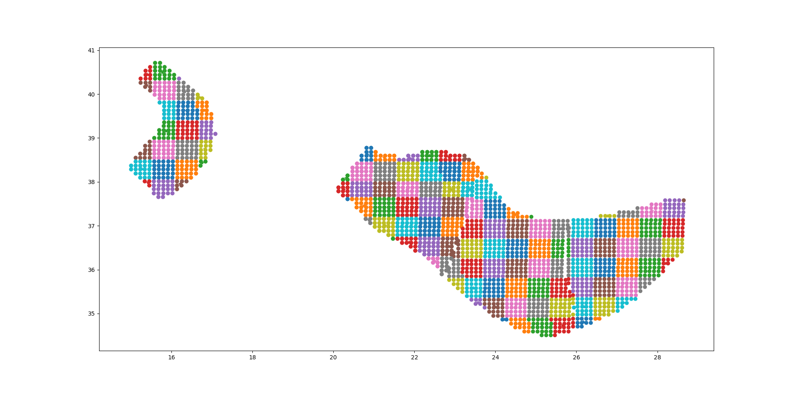

.. _performance-approximations:

Performance Approximations
==========================

The engine implements a few approximations to speed up the classical calculations: the point source gridding,
the ``pointsource_distance`` approximation, the choice of the ``ps_grid_spacing`` and the ``collapse_precision``
approximation. This page describes them, shows how to measure their effect and gives a worked example.

.. _point-source-gridding:

The point source gridding approximation
---------------------------------------

WARNING: *the point source gridding approximation is used only in classical calculations, not in event based calculations!*

Most hazard calculations are dominated by distributed seismicity, i.e. area sources and multipoint sources that for the 
engine are just regular point sources. In such situations the parameter governing the performance is the grid spacing: 
a calculation with a grid spacing of 50 km produces 25 times less ruptures and it is expected to be 25 times faster 
than a calculation with a grid spacing of 10 km.

The *point source gridding approximation* is a smart way of raising the grid spacing without losing too much precision 
and without losing too much performance.

The idea is two use two kinds of point sources: the original ones and a set of “effective” ones (instances of the class 
``CollapsedPointSource``) that essentially are the original sources averaged on a larger grid, determined by the parameter 
``ps_grid_spacing``.

The plot below should give the idea, the points being the original sources and the squares with ~25 sources each being 
associated to the collapsed sources:

For distant sites it is possible to use the large grid (i.e. the CollapsePointSources) without losing much precision, 
while for close points the original sources must be used.

The engine uses the parameter ``pointsource_distance`` to determine when to use the original sources and when to use 
the collapsed sources.

If the ``maximum_distance`` has a value of 500 km and the ``pointsource_distance`` a value of 50 km, then 
(50/500)^2 = 1% of the sites will be close and 99% of the sites will be far. Therefore you will able to use the 
collapsed sources for 99% percent of the sites and a huge speedup is to big expected (in reality things are a bit more 
complicated, since the engine also consider the fact that ruptures have a finite size, but you get the idea).

************************************************************************
How to determine the right value for the ``ps_grid_spacing`` parameter
************************************************************************

The recommended way is to set ``ps_grid_spacing = auto`` and to run the calculation with
``calculation_mode = preclassical``, for instance::

	$ oq run job.ini -p ps_grid_spacing=auto calculation_mode=preclassical

With this setting the engine determines both ``ps_grid_spacing`` and ``pointsource_distance`` (unless the
``pointsource_distance`` is set in the job.ini) by comparing the hazard of the point sources on a sample of sites
with the hazard of the exact calculation, and then stops. The chosen values are logged, and they are stored in the
datastore, so that a subsequent calculation started with ``--hc`` uses them.

The calibration works as follows (in engine v3.27, it may change in the future):

- the sample has at most 300 sites, it uses a single GMPE per tectonic region type,
  the two intensity measure types closest to 0.2 s and 1 s and one intensity level every two;
- the reference is the calculation without gridding and with a ``pointsource_distance`` of 100 km (1000 km would be
  exact, but too expensive for large maximum distances);
- the candidates are the grid spacings 50, 25 and 15 km, each one with the ``pointsource_distance`` values 15, 25 and
  50 km (if the ``pointsource_distance`` is set in the job.ini, only that value is tried);
- a candidate is acceptable if the 99th percentile of the relative error on the hazard maps, for the sites where the
  hazard is above 0.01 g, is at most 5%;
- the acceptable candidate with the smallest weight is chosen, where the weight is the estimated cost of the full
  calculation; if no candidate is acceptable, the most precise one is chosen.

For the ``job_vs30.ini`` file of the ``performance.zip`` archive (engine version 3.27) the calibration log is the
following, and the calibration takes a few seconds on 16 cores::

	 psgs   psd      time      weight  mean_err%  p99_err%
	   50    15       5.1      294562       1.35      7.15
	   15    15      10.7      478083       0.17      1.91
	   25    15       6.8      317373       0.45      3.39
	   50    25       5.3      338005       1.19      7.15
	   50    50       6.2      490575       0.89      7.19
	Using ps_grid_spacing=25.0, pointsource_distance=15.0

Here the 15 km grid with a ``pointsource_distance`` of 15 km and the 25 km grid with a ``pointsource_distance`` of
15 km are both acceptable, and the second one has the smallest weight, so it is chosen. The 50 km grid is not
acceptable for any ``pointsource_distance``.

Once the values are known, run the full calculation with them, for instance ``oq run job.ini -p ps_grid_spacing=25,
pointsource_distance=15``. The precision can be checked with ``oq compare hcurves`` and ``oq compare uhs``, and the
performance with ``oq show performance``.

If you want to explore other values, you can run a sensitivity analysis. The command ``oq sensitivity_analysis``
prints a bash script which creates one calculation for each combination of the parameters, given in TOML syntax::

	$ oq sensitivity_analysis job.ini 'ps_grid_spacing = [0, 25, 50]' > sa.sh
	$ bash sa.sh

The script runs the calculations one after the other, and at the end it collects them with ``oq collect_jobs``. The
calculation with ``ps_grid_spacing=0`` is the reference, but notice that it still uses the ``pointsource_distance``
approximation, with the default of 100 km, so it is not the exact calculation unless the ``pointsource_distance`` is set
to 1000 km as well. To speed up the sensitivity analysis on large models, set the environment variable
``OQ_SAMPLE_SITES=.01``, which uses 100 times less sites (``oq show performance`` shows the timings of the calculations).

Note that the calibration, the weights and the precision of the ``ps_grid_spacing`` approximation change at every
release, so only the results at a fixed release are meaningful and you should not expect the same numbers and
performance across releases even if the model and the parameters are the same.

**********************************************************************
The collapse_precision approximation
**********************************************************************

In version 3.27 we introduce an additional approximation which is able to collapse ruptures coming
from generic poissonian sources (i.e. not point sources).

The ``collapse_precision`` parameter merges the contexts of the same
site which differ only by a small change of distance. Two contexts are
merged when they have the same site, the same rupture parameters and
distances equal within the given relative precision: the distances are
grouped by rounding ``sign(d) * log(1 + |d|)`` divided by
``collapse_precision``; the sign is kept because some distances, such
as ``rx`` and ``ry0``, are signed (they are positive on one side of
the rupture and negative on the other), while ``rrup`` is always
positive. The merged context has the sum of the occurrence rates and
the average distance, weighted by the rates. The dip, strike, rake and
width are compared after rounding to one decimal place, while the
other rupture parameters must be equal.

The approximation is used only by the ``classical`` calculator, for the Poissonian sources: the nonparametric
sources and the non-Poissonian temporal occurrence models are never collapsed. The default is
``collapse_precision = 0``, meaning no collapsing, and a typical value is ``0.02`` or ``0.03``::

	collapse_precision = 0.03

Collapsing is useful only if many ruptures of a source are at similar distances from the same site, which is the case
for the far away sites and for the sources with few rupture parameters. It is not useful when the ruptures have many
different parameters: for instance, along a long fault two ruptures with the same magnitude are at different positions,
so their parameters almost never match, and GMPEs with many distance terms (such as the ones with rupture distance and
hanging-wall effects) make the contexts of different ruptures differ. In these cases the collapse removes few contexts
and it can even make the calculation slower, because of the extra work.

The effect of the collapse is logged in the ``cfactor`` line, which reports the reduction factor with the
collapse part as in::

	cfactor = 9_732, reduction factor 2.14 (psdist 1.63 x collapse 1.32)

If the contexts removed by the collapse are less than 10% of the contexts, the engine warns that
``collapse_precision`` should be turned off. Always check the runtime, since the collapse has a cost of its own.

For instance, on the ``performance.zip`` archive with ``ps_grid_spacing=30`` and engine version 3.27, the collapse removes
about 4% of the contexts (from 50,182,457 to 48,127,887, a reduction factor of 1.04) and it does not decrease the runtime,
which is 683 s without the collapse and 717 s with it.

***********************************************
Application: making the Canada model 26x faster
***********************************************

In order to give a concrete example, I ran the Canada 2015 model on 7 cities by using the following ``site_model.csv`` file:

+----------------+------+-----+------+----------+----------+
| custom_site_id | lon  | lat | vs30 |  z1pt0   |   z2pt5  |
+================+======+=====+======+==========+==========+
|     montre     | -73  | 45  | 368  | 393.6006 | 1.391181 |
+----------------+------+-----+------+----------+----------+
|     calgar     | -114 | 51  | 451  |290.6857  | 1.102391 |
+----------------+------+-----+------+----------+----------+
|     ottawa     | -75  | 45  | 246  | 492.3983 | 2.205382 |
+----------------+------+-----+------+----------+----------+
|     edmont     | -113 | 53  | 372  | 389.0669 | 1.374081 |
+----------------+------+-----+------+----------+----------+
|     toront     | -79  | 43  | 291  | 465.5151 | 1.819785 |
+----------------+------+-----+------+----------+----------+
|     winnip     | -97  | 50  | 229  | 499.7842 | 2.393656 |
+----------------+------+-----+------+----------+----------+
|     vancou     | -123 | 49  | 600  | 125.8340 | 0.795259 |
+----------------+------+-----+------+----------+----------+

Notice that we are using a ``custom_site_id`` field to identify the cities. This is possible only in engine versions 
>= 3.13, where ``custom_site_id`` has been extended to accept strings of at most 6 characters, while before only 
integers were accepted (we could have used a zip code instead).

If no special approximations are used, the calculation is extremely slow, since the model is extremely large. On the 
the GEM cluster (320 cores) it takes over 2 hours to process the 7 cities. The dominating operation, as of engine 3.13, 
is “computing mean_std” which takes, in total, 925,777 seconds split across the 320 cores, i.e. around 48 minutes per 
core. This is way too much and it would make impossible to run the full model with ~138,000 sites. An analysis shows 
that the calculation time is totally dominated by the point sources. Moreover, the engine prints a warning saying that 
I should use the ``pointsource_distance approximation``. Let’s do so, i.e. let us set ``pointsource_distance = 50``
in the job.ini file. That alone triples the speed of the engine, and the calculation times in “computing mean_std” goes 
down to 324,241 seconds, i.e. 16 minutes per core, in average. An analysis of the hazard curves shows that there is 
practically no difference between the original curves and the ones computed with the approximation on::

	$ oq compare hcurves PGA <first_calc_id> <second_calc_id>
	There are no differences within the tolerances atol=0.001, rtol=0%, sids=[0 1 2 3 4 5 6]

However, this is not enough. We are still too slow to run the full model in a reasonable amount of time. Enters the 
point source gridding. By setting ``ps_grid_spacing=50`` we can spectacularly reduce the calculation time to 35,974s, 
down by nearly an order of magnitude! This time ``oq compare hcurves`` produces some differences on the last city but 
they are minor and not affecting the hazard maps::

	$ oq compare hmaps PGA <first_calc_id> <third_calc_id>
	There are no differences within the tolerances atol=0.001, rtol=0%, sids=[0 1 2 3 4 5 6]

The following table collects the results:

+--------------------+-----------+----------------------+---------+
|     operation      | calc_time |         approx       | speedup |
+====================+===========+======================+=========+
| computing mean_std |  925_777  |       no approx      |    1x   |
+--------------------+-----------+----------------------+---------+
| computing mean_std |  324_241  | pointsource_distance |    3x   |
+--------------------+-----------+----------------------+---------+
| computing mean_std |   35_974  |    ps_grid_spacing   |    26x  |
+--------------------+-----------+----------------------+---------+

It should be noticed that if you have 130,000 sites it is likely that there will be a few sites where the point source 
gridding approximation gives results quite different for the exact results. The commands ``oq compare`` allows you to 
figure out which are the problematic sites, where they are and how big is the difference from the exact results.

You should take into account that even the “exact” results have uncertainties due to all kind of reasons, so even a 
large difference can be quite acceptable. In particular if the hazard is very low you can ignore any difference since 
it will have no impact on the risk.

Points with low hazard are expected to have large differences, this is why by default *oq compare* use an absolute 
tolerance of 0.001g, but you can raise that to 0.01g or more. You can also give a relative tolerance of 10% or more. 
Internally ``oq compare`` calls the function ``numpy.allclose`` see https://numpy.org/doc/stable/reference/generated/numpy.allclose.html 
for a description of how the tolerances work.

By increasing the ``pointsource_distance`` parameter and decreasing the ``ps_grid_spacing`` parameter one can make the 
approximation as precise as wanted, at the expense of a larger runtime.

NB: the fact that the Canada model with 7 cities can be made 26 times faster does not mean that the same speedup apply 
when you consider the full 130,000+ sites. A test with ``ps_grid_spacing=pointsource_distance=50`` gives a speedup of 7 
times, which is still very significant.

Measuring the reduction of the contexts
---------------------------------------

The ``classical`` calculator logs, at the end of the classical phase, the number of contexts it computes (``cfactor``)
and the reduction factor with respect to the exact calculation, i.e. with ``ps_grid_spacing=0`` and a
``pointsource_distance`` of 1000 km. The reduction factor is the product of two parts, which are both logged:

- the reduction due to the point-source gridding (``gridding``) or to the ``pointsource_distance`` approximation
  (``psdist``), and
- the reduction due to ``collapse_precision`` (``collapse``).

For instance, a line like::

	cfactor = 56_527_540, estimated reduction factor 17.52 (gridding 17.52 x collapse 1.00)

means that the gridded calculation computes about 17.5 times fewer contexts than the exact one. The factors
marked as ``estimated`` are computed from a fast estimate of the number of contexts, which is accurate to a few percent
(the estimated and the actual number of contexts of the exact calculation differ by 1.6% in the example below).
The runtime is not directly proportional to the number of contexts, so it is useful to measure it as well: the
classical time is the one reported in the logs by the line ``Received ... from classical``.

The following table shows the results of the ``performance.zip`` calculation, which can be downloaded from
https://downloads.openquake.org/jobs/performance.zip. The calculations were run with an AMD Ryzen 9
9955HX 16-Core Processor:

.. list-table::
   :header-rows: 1

   * - pointsource_distance
     - ps_grid_spacing
     - collapse_precision
     - classical time (s)
     - cfactor (contexts)
     - reduction factor
   * - 1000
     - 0
     - none
     - 1011
     - 1,006,014,489
     - 1.00
   * - 100
     - 0
     - none
     - 326
     - 300,941,271
     - 3.34 (psdist)
   * - 25
     - 25
     - none
     - 58
     - 56,527,540
     - 17.52 (gridding, estimated)
   * - 25
     - 25
     - 0.03
     - 64
     - 55,207,568
     - 17.94 (gridding, estimated)

Note that the efficiency of the collapse of the ruptures and of the ``pointsource_distance`` approximation depends very
much on the version of the engine: the numbers above are valid for the engine version 3.27 and they will change in
other versions, as well as they will depend on the hardware. They are meant to show how to read the logs, not
as a benchmark.
